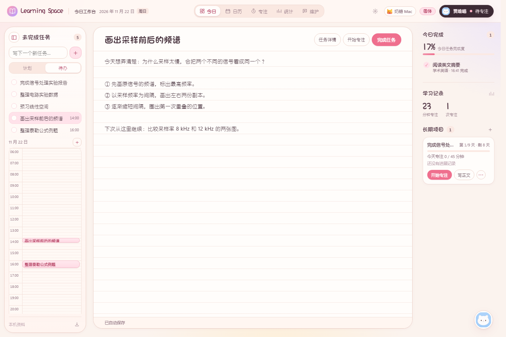
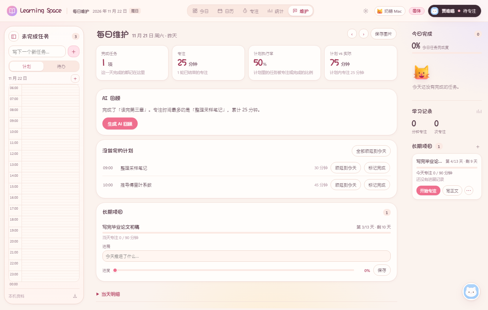
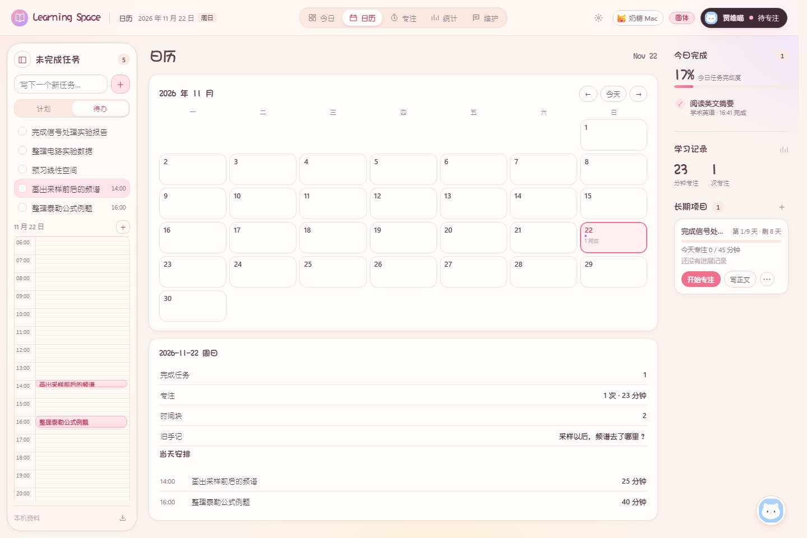
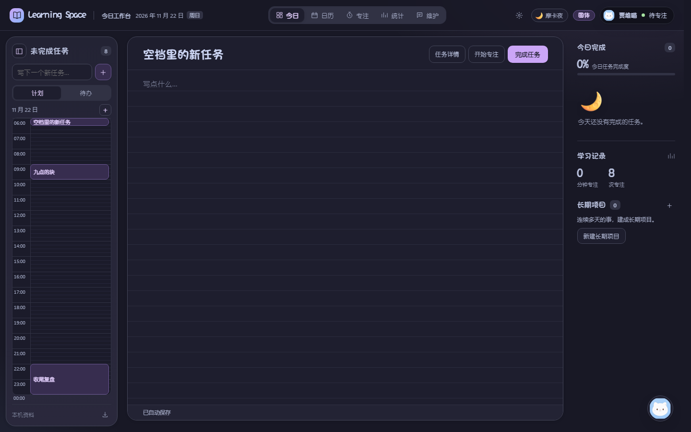

# 学习工作台 · Learning Workbench

**把「今天打算学什么」和「今天实际学了什么」放在同一张桌面上。**

把「画出采样前后的频谱」从待办拖到下午两点，点开时间块写下推导，再开始一轮专注。第二天打开工作台，你能看到昨天实际投入的分钟数、没做完的安排，以及实验报告还剩几天。适合同时要管课程、备考和长期项目的人。

[下载 Windows 版](https://github.com/aiyinsitan520/learning-workbench/releases/latest/download/Learning-Workbench-Windows-x64.zip) · [下载 Apple 芯片版](https://github.com/aiyinsitan520/learning-workbench/releases/latest/download/Learning-Workbench-macOS-arm64.dmg) · [下载 Intel Mac 版](https://github.com/aiyinsitan520/learning-workbench/releases/latest/download/Learning-Workbench-macOS-x64.dmg) · [版本记录与校验文件](https://github.com/aiyinsitan520/learning-workbench/releases/latest)



*图中是 Windows 上实际运行的工作台页面，使用独立演示数据拍摄。主页里的实验题、笔记和项目都可以换成你自己的。*

## 下载后怎么用

| 你的电脑 | 下载 | 打开方式 |
| --- | --- | --- |
| Windows 64 位（Intel / AMD） | [Windows x64 ZIP](https://github.com/aiyinsitan520/learning-workbench/releases/latest/download/Learning-Workbench-Windows-x64.zip) | 完整解压到一个文件夹，双击里面的 **Learning Workbench.exe**。 |
| Mac（M 系列芯片） | [Apple Silicon DMG](https://github.com/aiyinsitan520/learning-workbench/releases/latest/download/Learning-Workbench-macOS-arm64.dmg) | 打开磁盘映像，把 **Learning Workbench** 拖到「应用程序」，再打开。 |
| Mac（Intel 处理器） | [Intel DMG](https://github.com/aiyinsitan520/learning-workbench/releases/latest/download/Learning-Workbench-macOS-x64.dmg) | 同上。「关于本机」会显示芯片或处理器型号。 |

桌面包内置 Electron、Node.js 和 SQLite。第一次打开是空白工作台，可以直接建任务，模型配置可以留到以后。Windows 包未做商业代码签名，Mac 包使用临时签名，未经 Apple 公证，首次启动可能出现系统安全提示。

**想从命令行下载**，安装了 GitHub CLI 的电脑可以任选一条。下载后按表格打开。

```sh
gh release download --repo aiyinsitan520/learning-workbench --pattern '*Windows-x64.zip'
gh release download --repo aiyinsitan520/learning-workbench --pattern '*macOS-arm64.dmg'
gh release download --repo aiyinsitan520/learning-workbench --pattern '*macOS-x64.dmg'
```

### 更新到新版本

从 v1.1.0 起，桌面版可以在应用里更新：点左下角的版本号打开「软件更新」。

- **检查**：默认启动 1 分钟后检查一次，此后每 6 小时一次，发现新版只提醒，不会自己下载或安装；可以在对话框里关掉自动检查。检查只读取 GitHub 发布页上公开的更新清单，不上传任何资料。
- **下载**：只从本仓库对应版本的发布页下载。先核对更新清单的签名，再核对安装包的大小和 SHA-256，任何一项对不上都会拒绝。
- **安装（Windows）**：点「安装并重启」并确认后，工作台先保存正文、备份资料库，然后关闭，几秒后以新版本重新打开。旧版本留在程序文件夹旁边的「…previous」文件夹里，需要时可以手动换回。程序要放在能写入的位置（例如「文档」），放在 Program Files 里只能手动更新。
- **安装（Mac）**：校验通过后会打开新的安装包，把应用拖进「应用程序」替换旧版即可。Mac 包未经 Apple 公证，暂不做静默替换。

v1.0.0 没有这个功能，需要手动下载一次 v1.1.0；之后就可以在应用里更新了。资料放在系统的应用数据目录里，换版本不会丢。

### 选择数据源

从 v1.2.0 起，桌面菜单「数据源」可以在「本机数据库」和「服务器数据库」之间切换。窗口标题会显示当前数据源，重开应用会恢复上一次选择。Windows 的菜单在窗口上方，macOS 的菜单在屏幕顶部。

- **本机数据库**可以离线使用。启动时如果连不上服务器，会先打开本机库。
- **服务器数据库**可以让多台设备读写同一个私有工作台服务。两套数据库各自保存，离线写入留在本机库。

使用共享库前，先在服务器上启动工作台（默认监听服务器上的 `127.0.0.1:7321`）。每台电脑运行下面的命令，把 `user@server` 换成自己的 SSH 登录地址，然后在桌面版选择「服务器数据库」。

```sh
ssh -N -L 127.0.0.1:17322:127.0.0.1:7321 user@server
```

共享服务使用 SSH 认证，工作台自身没有账号登录。服务和转发端口均应监听回环地址。共享模式的页面与功能由服务器上的工作台版本决定。桌面版要更新安装包时，请先切到本机数据库，再打开左下角「软件更新」。

### 调节桌面页面大小

从 v1.2.1 起，可在桌面菜单「视图」中放大、缩小或恢复 100%。Windows 按 `Ctrl + +`（也可用 `Ctrl + =`）、`Ctrl + -`、`Ctrl + 0`，macOS 用 `⌘` 替换 `Ctrl`。字体、图片和布局会像浏览器页面一样一起缩放，本机和服务器数据源均可使用。

## 第一次用，可以这样学一轮

1. 在左栏「待办」写下一个能做完的动作，例如「画出采样频谱」。把它拖进今天的时间轴，拖动底边留出 25 分钟。
2. 点击任务标题，在中央记下思路、公式或卡住的问题。短暂停键会自动保存，下次点击同一任务就能接着写。
3. 切到「专注」开始计时。结束后在任务正文右上角点「完成任务」。切换页面不影响计时。
4. 第二天打开「每日维护」，对照计划和实际投入，把值得继续做的时间块顺延到今天。

## 各个功能解决什么问题

| 学习时遇到的问题 | 工作台里的用法 |
| --- | --- |
| 待办越记越多，但今天到底何时动手？ | 待办和当天 06:00–24:00 时间轴并排。把任务拖进去，按 5 分钟移动，拖底边调整时长。同一任务可以安排多次。吃饭、上课等固定事项也能只进日程。 |
| 第二天想继续，忘了上次做到哪一步 | 每项任务有独立正文。点待办或时间块都能回到同一份笔记。支持自动保存、手动保存、冲突后保留草稿和重试。改名、完成、撤销也能就地操作。 |
| 换到教材或编辑器后，看不到计时器 | 可以绑定任务计时，也可以自由专注，支持暂停、继续、提前结束和到时结算。Windows 的桌面灵动岛常驻在前，展开后可控制计时、勾掉任务。其他系统的小窗取决于画中画支持。白猫入口和主界面共用同一轮计时。 |
| 论文和实验报告跨好几周，容易被日常作业挤掉 | 长期项目可设目标、期限和每日投入，自动关联一个主任务，可以排期、写正文、记进展、完成或归档。右栏显示已经进行了几天、还剩几天和今天投入了多少。 |
| 排满了一天，复盘却只能凭印象 | 日历按天回看，统计从已记录的专注时长汇总。每日维护列出已完成任务、专注、计划执行率、计划与实际差距；未完成时间块可以逐项或批量顺延，还可以把回顾保存成图片。 |
| 想让 AI 帮忙复盘，又想决定把哪些记录交给谁 | 可选接入 OpenAI 兼容或 Anthropic 协议的供应商，拉取模型、测试连接、切换配置或导入已有配置。点击生成回顾时会把所选日期的任务、专注、排期和项目摘要发给当前供应商。结果本地缓存。也可以自行导出 Markdown / JSON 给其他工具。 |
| 晚上觉得界面太亮，或者不习惯默认字体 | 可换奶糖 Mac、薄荷、拿铁、摩卡夜、极光、晨玫瑰六套皮肤，切换圆体或系统字体，折叠侧栏。主题偏好留在本机。 |
| 想换电脑，还要带走任务和笔记 | 工作台用本机 SQLite。左栏下载按钮导出整库 JSON，恢复时导入空库。当前导入请求上限为 512 KiB。模型密钥独立保存在本机配置文件中，不随整库备份导出。 |

**键盘操作**　`1`–`5` 切换主页面，`N` 新建任务，专注页按空格控制计时，`Ctrl / ⌘ + S` 保存正文，`Esc` 收起浮层。

## 实机图片

**专注** · 中央保留当前任务和倒计时，右侧能看到今天已投入的时间。


**每日维护** · 昨天计划了 75 分钟，实际专注 25 分钟。沿着未完成清单，可以决定今天接着做什么。



<details><summary>展开看月历和深色皮肤</summary>





</details>

## 从源码启动

安装 Node.js 24 后运行以下命令，无需安装 npm 依赖。

```sh
git clone https://github.com/aiyinsitan520/learning-workbench.git
cd learning-workbench
node app/server.js
```

打开 `http://127.0.0.1:7321`。想先试用截图里的课程任务，可以在**新的源码副本**里先执行 `node app/seed.js` 再启动。Windows 也可以双击根目录的「学习工作台.cmd」。

桌面版使用本机端口 `17321`，源码版默认使用 `7321`，各自使用独立数据库。已有源码版用户可以先导出 JSON，再向**空白桌面版**导入。桌面版打开时，在备份文件所在目录执行：

```sh
curl -f -H "Content-Type: application/json" --data-binary "@backup.json" http://127.0.0.1:17321/api/import
```

Windows PowerShell 请将 `curl` 写成 `curl.exe`。想让自己的 AI 工具读取最近 30 天的学习摘要，可以从正在运行的桌面版导出 Markdown：

```sh
curl -f "http://127.0.0.1:17321/api/context?days=30&format=md" -o study-month.md
```

摘要默认省略任务正文。按北京时间分日，支持单人本机使用、通过私有连接共享服务器库，以及通过备份进行数据迁移。[数据格式和导出选项](docs/DATA_FOR_AI.md) · [运行说明与测试命令](app/README.md) · [桌面打包脚本](desktop/build.py)

如果这张桌面帮你把一项学习计划做完了，欢迎点个 **Star**。也欢迎在 [Issues](https://github.com/aiyinsitan520/learning-workbench/issues) 里写下你试过的学习场景、卡住的步骤和系统版本。
