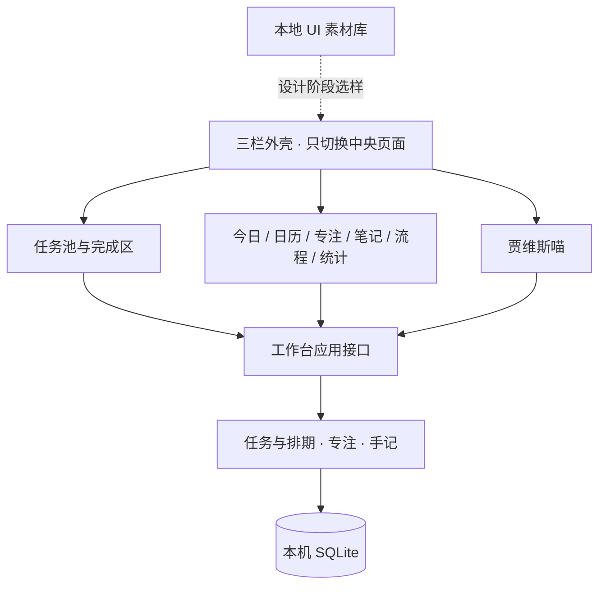

# Learning Space 学习工作台架构

2026-11-20 · 第一版架构基线 · Codex 规划和验收，DSH 按单实施

## 一天的学习怎样穿过系统

左栏创建“画出采样前后的频谱”，此时它只有一个任务 ID。点击安排后，时间线上出现一段引用该 ID 的时间块。贾维斯喵读取同一任务，启动一轮专注。学生切回手记写下难点，再拖动流程卡。结束计时时，右侧增加一条实际用时记录；学生自己勾选完成后，任务才从左栏移入完成区。撤销完成仍可查到先前的用时和笔记。



## 模块与归属

| 模块 | 拥有什么 | 主要约束 |
| --- | --- | --- |
| 三栏外壳 | 中央路由、每页滚动位置、当前选中项、侧栏宽度 | 切页只更换中间视图。计时和写入由应用层管理。窗口偏好后续由桌面端单独保存。 |
| 任务与排期 | 待办、完成时间、时间块 | 一个任务可安排多次。改期更新原时间块，取消排期仅删除该块。今日完成按实际完成时间筛选。 |
| 专注 | 开始、暂停、恢复、提前结束、到时结束 | 全应用最多一轮运行或暂停。自由专注允许没有任务。结束计时与完成任务是两个操作。 |
| 混合手记 | 每日文档、正文、难点、思考、流程、任务引用、块顺序 | 今日页和笔记页读取同一文档。正文、卡片及新顺序作为一次事务保存。 |
| 统计 | 按日汇总专注次数、实际秒数和任务完成数 | 从学习记录计算。展示分钟时最后换算，防止多个短会话分别取整后丢时长。 |
| 贾维斯喵 | 推荐下一项任务、发起工作台操作、展示当前专注状态 | 初期优先用户选中项，其次最近安排的待办。无待办时可自由专注。独立贾维喵服务留到后续通过适配器连接。 |

## 技术落点

- 初稿仍可双击 `index.html`。现有 `studio.js` 的任务、笔记与计时都在当前页面的内存里，作为交互对照。正式桌面层沿用原聊天的 React、TypeScript、Tauri 2、SQLite 方向。编辑器先支持现有块种，具体编辑器库待编辑手感验证后选定。
- [应用接口](architecture/workbench.d.ts) 是页面和管家的共同入口。读取指定日期及其时区的工作台视图，写入使用明确命令。正式实现先接任务和时间线这一条纵向流程，再接其余模块。
- [SQLite 建表脚本](architecture/schema.sql) 可在新库执行。使用 SQLite 3.38 或更新版本。每个连接都开启外键；桌面适配器按 `user_version` 识别版本，首次创建和后续迁移分别处理。桌面运行时数据库路径由应用数据目录提供。
- 写入流程为组件发命令、应用层校验、仓储执行事务、成功后刷新有关视图。存储失败时保留编辑草稿并提示重试。创建命令复用原 ID；相同 ID 和请求内容相同可视为成功，不同则报告冲突。
- 左栏日计划的显示范围为 06:00–24:00。拖动主体和底边分别改开始时间和时长，共用原时间块 ID。待办拖入为原任务创建时间块。「计划」视图新建任务从当日最晚结束时刻接续，创建任务和排期依次走现有命令，同一次提交重试复用任务及时间块 ID。旧排期按原值保留在数据层和顶栏。
- 专注用 UTC 秒存储时间锚点。运行时累计值为已累计秒数加上距最近启动或恢复的时长，下限为已累计值，上限为计划时长。暂停时冻结秒数。恢复后重新记锚点。到时以预计截止时刻结算；重启时同样检查截止时刻，带版本号更新，重复回调只能结算一次。第一版按结束时刻所在的本地日期归集整轮专注。
- 保存手记时校验文档版本，以数组顺序写入块位置；在同一事务内更新全部受影响的块。并发写入遇到旧版本返回冲突并保留用户草稿。每日范围由本地日期及时区换算为 UTC 的左闭右开区间。

## 后续怎样挑 UI 素材

素材库在 `E:/AI项目/软件UI素材库`。进入某个页面的设计轮时，先读库内 AGENTS、偏好、索引和既有决策，再打开相关实图或录屏。给用户看同一任务、同一数据下的候选效果，标出素材 ID、借鉴的动作、适用位置。用户选择后记录到决策表，再实现这一页。库里没有合适内容的区域可继续使用基础布局。

可先按三个具体问题找参考：中央页面切换怎样保持方向感；难点卡展开后怎样回到原位置；专注时猫管家怎样收起。以上均为待选位置。本轮只确认架构，素材库由设计阶段读取，软件运行和开发验收均可离线进行。

## 交付顺序与验收

| 阶段 | 可交付结果 | Codex 验收方式 |
| --- | --- | --- |
| A 架构基线（本轮） | 模块职责、读写接口、SQLite 模式、可重复检查 | 在临时库验证关系和活动专注约束；单独核验笔记顺序、落盘重开及版本。 |
| B 第一条真实学习流程 | 左栏新建 → 中央排期 → 勾选完成 → 右侧撤销，数据写入应用私有库 | 使用空的测试库操作；关窗并重开，对照原 ID、排期和完成状态。模拟保存失败，输入仍可重试。 |
| C 专注与手记 | 切页继续计时，暂停恢复，正文和卡片共用一份文档 | 使用可控制的时钟检查暂停、休眠跨截止点和重复结束；两次打开同一份笔记验证冲突保护。 |
| D 管家与视觉 | 管家复用已验收命令；按页面提供素材候选，应用用户选定的做法 | 演示从猫入口启动与从番茄钟入口启动得到相同记录；逐页对照选样和窄窗口行为。 |
| E 桌面交付 | Windows 与 Mac 各一轮独立验收 | 分机验证重启、离线、窗口尺寸和数据恢复，逐项列出仍待验证的能力。 |

### 下一张 DSH 工单

目标为 B 阶段的任务仓储。先读取本架构、接口和 schema。桌面端建议置于本项目的 `app/`；若接手的 DSH 已有正式工程，优先复用该工程。前端在 `app/src/` 分设三栏外壳、页面和桌面命令适配器，数据库迁移与命令实现在 `app/src-tauri/`。首单只实现任务创建、改期、完成/撤销及按日读取。用临时库测试重试、外键和重开；返回改动路径、测试命令及原始输出。Codex 核对实际差异并走一遍用户路径后，再分派 UI 接线。验收前沿用现有样稿外观。

## 实施进度（DSH 实施记录）

| 阶段 | 状态 | 落点 | 验证 |
| --- | --- | --- | --- |
| A 架构基线 | 已完成 | `architecture/` | `check_schema.py` 17/17 两轮一致；`check_reopen.py` 全通过 |
| B 第一条真实学习流程 | 已完成 | `app/` | 新建 → 排期 → 改期 → 完成 → 撤销，数据落 `app/data/workbench.db`，重启后仍在 |
| C 专注与手记 | 已完成 | `app/` | 暂停冻结、恢复续计、跨截止点按计划时长结算、重复结束只结算一次；手记版本冲突返回 409 且不改任何行 |
| D 管家与视觉 | 已完成 | `app/public/` | 管家浮层与灵动岛复用同一套命令（猫入口、灵动岛入口、番茄钟入口得到同一条记录）；推荐顺序：选中 → 今日最早安排 → 最早创建；已移植用户认可的 Mac 手绘视觉（顶栏页面组、灵动岛、可折叠侧栏、圆体、横线纸手记） |
| E 桌面交付 | 未开始 | — | 尚无 Tauri 壳；当前是本机 HTTP + SQLite。本机无 Rust 工具链，构建 Tauri 需先安装，待用户授权 |

`app/` 是零依赖实现（Node 内置 `node:sqlite` + 原生 ES 模块），不需要 `npm install`。
界面外观取用户已认可的 Mac 手绘方案：`app/public/mac.css` 移植自 `Mac工作台.html` 与 `手绘布局.css`，
样式源文件保留在根目录作为设计稿；`app/` 里的实现是正式版。
根目录 `index.html` / `studio.js` / `studio.css` 保持为交互对照样稿，未改动。

### 重跑架构检查

在项目目录执行下面两条命令。第一条在内存库检查任务、排期和活动专注的约束。第二条创建并关闭临时文件数据库，再次打开核对内容，结束时清理临时目录。二者均使用 Python 标准库。

```powershell
python architecture/check_schema.py
python architecture/check_reopen.py
```

数据备份：左栏底部下载图标导出整库 JSON（`GET /api/export`）；`POST /api/import` 只接受空库。

应用层与界面的检查（在项目目录执行）：

```powershell
node --test app/test/workbench.test.js app/test/server.test.js   # 数据层 + 服务层
node --test app/test/ui.test.mjs                                 # 真 Chrome 端到端，截图写 app/shots/
```

独立的只读验收层（不修改任何项目文件，可与 `app/` 的改动并行跑）：

```powershell
python verify/check_contract.py    # 契约：schema / 路由 / 命令 / 模块接线 / 静态资源
node verify/check_behavior.mjs     # 行为：真起服务 + 临时库跑一遍用户路径
verify/run_all.cmd                 # 两套一起跑
```


## 窗口设计候选 · 2026-11-20

2026-11-20 · 学习工作台窗口设计候选已交付。初稿首页的「预览 Mac 布局」打开 Mac工作台.html。素材库 shell-001 对应两张状态图及单文件离线样例；重点结合 overlay-001、navigation-002、navigation-001。Chrome 验证六页切换、任务栏折叠、焦点恢复、专注岛与编辑状态、390px 宽度及减少动态效果。下一步通过实图选定布局后接正式 app。本次未覆盖 macOS 原生窗口。 入口为 [Mac 工作台](Mac工作台.html)。

### 手绘布局修订 · 2026-11-20

用户已认可 Mac 视觉风格。当前 [可点击样稿](Mac工作台.html) 和 [1440×900 样图](03-手绘布局修订.png) 以原图五区为准。六个页面入口回到右上角，灵动岛留在顶部，中央时间线下直接进入可编辑手记。素材库 shell-001 保留上一版作为风格参考。正式 app 的布局验收以用户选定的修订稿为准。
2026-11-20 · 手绘布局圆体试排。手绘布局.css 将主标题映射至本机华康方圆体 W7、手记正文与任务名映射至幼圆，小字号课程和时间单独保留系统字体。当前样稿 Mac工作台.html；样图 04-圆体工作台.png。Windows Chrome 实际命中字形，经 1440/1024/390 宽度与笔记切页验收。其他设备按本机字体回退；应用实现未移植。下一次从圆体样图继续核对具体字体。

2026-11-20 · 当前 Mac 样稿默认正楷，顶栏灵动岛左侧的「圆体」开关即时切换并在同一浏览器记忆。改动 Mac工作台.html、手绘布局.css，样图 05-正楷与字体开关.png。Windows Chrome 验证默认 KaiTi、开启后华康方圆体、双向刷新保留、切换时保留笔记和计时；正式 app 的设置接入待同步。

2026-11-20 · 用户以侧栏截图澄清普通字体：Mac工作台.html 现默认系统无衬线，手绘布局.css 采用常规任务字重，原圆体开关继续记忆选择。Windows Chrome 实测列表、标题、笔记为 Microsoft YaHei；双向刷新测试通过。验收图 06-系统字体.png。

2026-11-20 · 用户选定 04-圆体工作台.png。Mac工作台.html 恢复圆体默认，圆体开关可切换系统字体。此次启用新的本地偏好键，让旧版普通字体设置在首次刷新时回到圆体，之后继续记住用户选择。Windows Chrome 实测默认华康方圆体 W7 与幼圆，双向刷新和切换时保留手记均通过。当前验收范围为可点击样稿，正式 app 的字体接入待同步。

2026-11-20 · 可运行版布局对齐。顶栏原六按钮改为常驻时间线，今日页中央移除原时间线。右上功能选择负责中央页面切换；窄窗口将同一组功能放在中央内容前面。改动 app/public/index.html、mac.css、js/app.js、js/views.js、app/test/ui.test.mjs 及 README。临时库全套 82/82 通过，最终版经 7321 实测六页、键盘焦点、排期按钮、日历选日及返回今天，360–1440px 无横向溢出。若下一轮调整布局，从 app/public/index.html 的 headerTimeline 和 tools 继续。

2026-11-20 · 左栏日计划和精简待办已实现。默认显示可滚动的日时间轴，点空白分段选任务生成圆角块。下沿拖动和方向键按 5 分钟调节，松手写入现有排期库并同步顶栏。待办只有单行任务与首个排期时间，移除已安排和待安排分组。改动 app/public/index.html、planner.css、studio.css、mac.css、js/planner.js、js/app.js、js/views.js、app/test/ui.test.mjs 及 README。临时库 82/82 通过。真实 Chrome 另测 30→60 分钟拖动、刷新保留、同任务多块、35 条待办独立滚动和 360–1440px 窄宽。后续若调整时间块，从 planner.js 和 planner.css 继续。

2026-11-20 · 今日工作台的任务正文已上线。待办、左栏计划和折叠任务入口直达中央编辑器，详情与专注由编辑器工具栏进入。正文按任务 ID 存储，350 ms 自动保存，切换会提交原任务草稿，保存错误保留草稿，旧版本写入返回冲突。新增 architecture/task_notes.sql 和 app/public/js/task-notes.js，配套更新 db.js、server.js、api.js、app.js、views.js、planner.js、mac.css、契约和测试。备份后以原数据库和端口 7321 重启，旧库副本完整性检查 ok，Node/Chrome 全套 84/84，当前 7321 直接打开待办正文验收通过。若后续调整编辑体验，从 task-notes.js 和 mac.css 继续。

2026-11-20 · DSH 交付 verify/ 的独立验收已复跑。python verify/check_contract.py 11/11，node verify/check_behavior.mjs 14/14，模块接线匹配 5 个模块的 25 个导入名。verify 行为脚本校验导出内容，任务正文隔离、备份导入往返及浏览器自动保存由 app 主套覆盖。HUD 工单回传 m-4e827a591252。后续回归先跑 verify/run_all.cmd，再跑 app 测试套件，涉及正文时从 app/test/server.test.js 和 app/test/ui.test.mjs 继续。

2026-11-20 · 复核补记。DSH 曾执行提议补丁并改动 app/lib/db.js、app/server.js。Codex 已按写入前哈希恢复原始字节，通过 m-8967bc9c0234 通知 DSH 停止本工单写入。Codex 对齐 verify/check_behavior.mjs 三项和其 README。契约 11/11，行为 17/17，应用服务测试 17/17。工作台继续使用独立任务正文端点。本地 7321 健康检查成功。

2026-11-20 · 左栏日计划时间轴压缩为每小时 32px，打开或换日从 06:00 开始。18 个可排期小时之后显示次日 00:00，午夜为收尾刻度。改动 app/public/js/planner.js、app/public/planner.css、app/test/ui.test.mjs。7321 实测 1440×900 一屏看到首尾，440px 可滚动到底。临时库的 23:45–00:00 排期和刷新通过，两项日计划浏览器用例通过。全套仍有其他断言失败，其中首屏旧断言要求 6 个右栏按钮，当前为 4 个。下一轮动时间轴时从 planner.js、planner.css 和日计划用例继续。

2026-11-20 · 用户确认左侧日计划只显示 06:00–00:00 共 18 小时。planner.js 移除零点前的日期前缀，同步 ui.test.mjs 刻度断言。7321 上 Chrome 验证 18 个小时格及 00:00 收尾标签通过。后续从 planner.js 的 renderAxis 继续。

2026-11-20 · 学习工作台左栏固定生成 06:00–23:00 的 18 个可排期小时格，00:00 为底部刻度。新增、拖动和调整时长共用午夜截止边界，超出范围的时间块显示裁到边界。改动 app/public/js/planner.js、app/public/planner.css、app/test/ui.test.mjs。重新打开 7321 实测 18 个小时格、底部标签 00:00、午夜无排期按钮。两项日计划浏览器测试通过。截图所在旧标签未直接核验。后续从 planner.js 的 renderAxis 和日计划测试继续。

2026-11-20 · 今日工作台支持点击正文上方任务名称直接改名，回车或失去焦点后保存，Esc 取消。app/public/js/task-notes.js、app/public/js/app.js 与 app/public/mac.css 接入既有 updateTask，名称在待办和时间块同步更新，正文和排期沿用原任务 ID。app/test/ui.test.mjs 用临时库验证改名、同步、刷新、正文隔离、日计划和控制台检查共 5 项通过。仓储及服务测试 55/55 通过。未重跑完整浏览器套件。后续从 task-notes.js 的 bindTitle 和任务名称测试继续。

2026-11-20 · 按用户截图恢复今日工作台「贾维斯喵管家」专注卡，使用原有 desk.png 白猫插画，放在任务编辑器上方。有进行中或暂停的专注时显示，能回到同一轮计时，结束后收起。编辑器留在同页，原位改名和正文自动保存继续通过。修改 app/public/index.html、app/public/js/app.js、app/public/js/task-notes.js、app/public/mac.css 与 app/test/ui.test.mjs。Chrome 临时库 6 项相关用例通过，含 390px 卡片、暂停、返回原会话与首页到时结算；仓储及服务测试 55/55。7321 页面与资源已核对，本轮未重跑完整浏览器套件。后续从 index.html 的 homeFocus 和 app.js 的 drawHomeFocus 继续。

2026-11-20 · 新增右栏「昨日总结」。按服务时区读取昨日完成项、已结束的专注、排期数量与学习手记，使用贾维斯喵插画绘制本地总结卡，可导出 PNG。输入 DeepSeek Key 并主动生成后，浏览器直接请求 deepseek-flash，密钥仅保存在标签页内存，AI 正文按昨日记录指纹缓存。实现入口为 app/public/js/review.js、review-data.js 和 app/public/review.css，页面接线在 index.html、js/app.js、js/views.js。验收见 app/test/yesterday.test.mjs，覆盖日期边界、昨日数据过滤、无 Key 模板、模拟鉴权失败及成功、刷新、窄屏和 PNG 下载。7321 实际入口已验证，仓储及服务测试 55/55。真实 Key 计费生成待持有者使用时验证。
